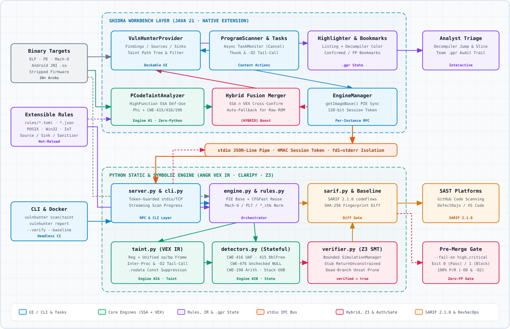

# VulnHunter4Ghidra

**Hybrid High P-Code SSA & angr VEX/Z3 vulnerability detection and taint analysis workbench for native binaries.**

[中文文档](README_CN.md) · [Interactive Architecture & Docs Site (GitHub Pages)](https://overkazaf.github.io/VulnHunter4Ghidra/)

---

VulnHunter4Ghidra uncovers memory corruption, pointer lifecycle, integer overflow, and injection vulnerabilities in compiled native binaries (`ELF`, `PE`, `Mach-O`, `.so`, `.dylib`, raw firmware). It runs both as an interactive **Ghidra Workbench** (fusing Ghidra Decompiler High P-Code SSA with Python `angr` VEX + Z3) and as a headless **SARIF 2.1.0 CLI / Docker scanner** for DevSecOps CI/CD gates.

## Key Features

- **Hybrid Dual-Engine Architecture (Ghidra High P-Code SSA + angr VEX/Z3)** — fuses Ghidra Decompiler's native `HighFunction` SSA def-use analyzer (supporting all 20+ Ghidra SLEIGH processors, raw firmware dumps, and zero-Python offline mode) with Python `angr` VEX IR + Z3 verification
- **Optimization-Resilient (`-O0` to `-O2`/`-Os`) Taint Analysis** — tracks register, stack-slot, buffer, inter-procedural argument/return, and `-O2` tail-call (`jmp`/`b` jumpout) data flows while filtering read-only constant format/command literals and bounded stack copies
- **Stateful Pointer & Arithmetic CWE Detectors** — dedicated VEX & SSA state machines for Use-After-Free (`CWE-416`, recognizing `p = NULL` and reallocation sanitization), Double Free (`CWE-415`), Unchecked NULL Dereference (`CWE-476`), Integer Overflow to Allocation/Copy (`CWE-190`), and Stack Frame OOB Write (`CWE-120`)
- **Z3 Symbolic Feasibility Verification** — bounded symbolic reachability (`--verify`) confirms satisfiable path constraints (`verified: true`) and prunes contradictory dead branches
- **Interactive Ghidra Workbench** — dockable `Findings` / `Sources` / `Sinks` tables, step-by-step `Taint Path` tree with one-click Listing/Decompiler navigation, `ColorizingService` path highlighting, background cancellable `Task` execution, and `Bookmark` triage persistence (`CONFIRMED` / `FALSE_POSITIVE`)
- **Extensible Rule Packs** — load custom `.toml` / `.json` Source, Sink, and Sanitizer rules (see `rules/embedded_iot.toml`) or mark custom nodes via right-click in Ghidra's Listing or Decompiler
- **DevSecOps & SARIF 2.1.0 Ready** — exports OASIS SARIF 2.1.0 (`--format sarif`) with `codeFlows` and `security-severity` for GitHub Code Scanning / DefectDojo, plus `--baseline` differential CI gating and `--fail-on` severity thresholds

## Architecture



The Java plugin aligns Ghidra's image base (`getImageBase()`) with the Python engine over an isolated, session-token-authenticated `stdio` JSON-line pipe (eliminating TCP port collisions across multiple Ghidra instances and preventing unauthorized local socket access). In **Hybrid Mode**, findings confirmed independently by both Ghidra High P-Code SSA and `angr` VEX are automatically promoted to high confidence with merged evidence.

## Installation

### Prerequisites

- **Ghidra** 11.x+
- **Java** 21+ (for building the Ghidra extension)
- **Python** 3.10+ with `angr` *(optional in `P-Code SSA Only` mode; required for Hybrid / CLI / Z3)*

### Build Ghidra Extension

```bash
export GHIDRA_INSTALL_DIR=/path/to/ghidra_11.x
gradle buildExtension -PGHIDRA_INSTALL_DIR=$GHIDRA_INSTALL_DIR

# Install: File → Install Extensions... in Ghidra, or extract dist/*.zip to $GHIDRA_INSTALL_DIR/Extensions/Ghidra
```

### Python Engine & CLI Setup

```bash
python3 -m venv .venv
source .venv/bin/activate
pip install -e .

# Verify CLI
vulnhunter --help
```

## Usage

### Ghidra Workbench Mode

1. Open a target binary or firmware image in Ghidra's CodeBrowser and enable **VulnHunter4Ghidra** (**File → Configure → Analysis**).
2. In the **VulnHunter4Ghidra — Taint & CWE Workbench** dockable panel:
   - Choose Engine Mode: **`Hybrid (P-Code + angr)`** (default), **`P-Code SSA Only`** (offline / exotic MCUs), or **`angr VEX Only`**.
   - Adjust inter-procedural **Depth**, toggle **Z3 Verify**, and click **Scan & Analyze**.
3. **Interactive Triage & Navigation**:
   - Select any row in **Findings** to jump to the sink and highlight `Source` (blue), `Path` (amber), and `Sink` (red) in both Listing and Decompiler.
   - Click any hop in the **Taint Path** tree to step through the data flow.
   - Right-click a finding to mark **`CONFIRMED`** or **`FALSE_POSITIVE`** (persisted into the `.gpr` database via Ghidra Bookmarks), or click **Export...** to save `.sarif` / `.json`.
   - Right-click any instruction or function in the Listing or Decompiler to run **Analyze Current Function** or mark a **Custom Source / Custom Sink / Sanitizer**.

### Standalone CLI & Docker Mode

```bash
# Quick scan: identify sources and sinks (with optional custom firmware/API rules)
vulnhunter scan ./target_binary --rules rules/embedded_iot.toml

# Full taint + stateful CWE lifecycle analysis with Z3 symbolic feasibility verification
vulnhunter taint ./target_binary --depth 8 --verify

# Export OASIS SARIF 2.1.0 for GitHub Code Scanning / VS Code SARIF Viewer / DefectDojo
vulnhunter report ./target_binary --verify --format sarif -o vulnhunter.sarif

# Differential CI gate: suppress pre-existing baseline findings, fail only on new High/Critical issues
vulnhunter report ./target_binary --baseline baseline.sarif --fail-on high --json

# Run via Docker
docker build -t vulnhunter .
docker run --rm -v "$PWD:/workspace" vulnhunter report /workspace/target_binary --format sarif
```

**Exit codes** (CI-friendly):

| Code | Meaning |
|------|---------|
| `0`  | Clean (no findings matching `--fail-on` threshold after `--baseline` filtering) |
| `1`  | Gating vulnerability findings detected |
| `2`  | Analysis or runtime error |

**JSON output example:**

```json
{
  "binary": "./target_binary",
  "arch": "AMD64",
  "base_addr": "0x400000",
  "functions_scanned": 142,
  "total_sources": 23,
  "total_sinks": 18,
  "taint_paths": 2,
  "findings_count": 2,
  "suppressed_by_baseline": 0,
  "findings": [
    {
      "finding_id": 1,
      "fingerprint": "9f82c10e4a7b31d2",
      "cwe": "CWE-78",
      "severity": "critical",
      "confidence": "high",
      "verified": true,
      "title": "command_injection: system in handle_cgi",
      "description": "User-controlled data from Call to fgets() flows to system() at 0x401234",
      "evidence": [
        "VEX data-flow confirmed taint in system() arg [0]",
        "Z3 symbolic feasibility verified (satisfiable path constraints)"
      ],
      "taint_path": {
        "source": { "address": "0x401190", "func_name": "handle_cgi", "source_type": "fgets" },
        "sink": { "address": "0x401234", "func_name": "handle_cgi", "callee_name": "system", "cwe": "CWE-78" },
        "path_addrs": ["0x401180", "0x401220"],
        "path_funcs": ["handle_cgi"],
        "path_length": 2,
        "confidence": "high"
      }
    }
  ],
  "severity_summary": { "critical": 2 }
}
```

### CI/CD Integration (GitHub Code Scanning + Baseline Gate)

```yaml
- name: Binary CWE Scan & SARIF Upload
  run: |
    pip install .
    vulnhunter report ./build/app --verify --format sarif -o vulnhunter.sarif
    vulnhunter report ./build/app --baseline .sec/baseline.sarif --fail-on high

- name: Upload SARIF to GitHub Security
  if: always()
  uses: github/codeql-action/upload-sarif@v3
  with:
    sarif_file: vulnhunter.sarif
```

---

## Benchmark Scorecard

VulnHunter4Ghidra ships with an automated Juliet-style paired `bad_*` / `good_*` native C benchmark corpus (`python -m benchmark.run_benchmark --opt all`) covering all 7 CWE classes under both unoptimized (`-O0`) and release-optimized (`-O2`, including tail-call optimization and register promotion) builds:

| Compiler Level | Vulnerable (`bad_*`) | Patched (`good_*`) | True Positives | False Positives | Precision | Recall | F1 Score |
|---|---|---|---|---|---|---|---|
| `clang -O0` (with Z3 verify) | 7 | 7 | 7 | 0 | **100.0%** | **100.0%** | **100.0%** |
| `clang -O2` (tail-calls & reg-alloc) | 7 | 7 | 7 | 0 | **100.0%** | **100.0%** | **100.0%** |

---

## Comparison with Other Tools

### VulnHunter4Ghidra vs. AppShark (ByteDance)

[AppShark](https://github.com/niceas/appshark) is ByteDance's open-source static taint analyzer for Android APKs. For Android apps bundling JNI `.so` libraries, use AppShark on the Java/Kotlin layer and VulnHunter4Ghidra on the native `.so` libraries:

| | VulnHunter4Ghidra | AppShark |
|---|---|---|
| **Target** | Native binaries (`ELF`, `PE`, `Mach-O`, `.so`, firmware) | Android APK (Java/Dalvik bytecode) |
| **Analysis Level** | Machine code / Decompiler SSA & VEX IR | Java / Jimple IR |
| **Engine** | Hybrid: Ghidra High P-Code SSA + angr VEX + Z3 | Soot / FlowDroid (Jimple-based) |
| **Architecture** | 20+ (x86, x64, ARM/AArch64, MIPS, PowerPC, RISC-V, ...) | Dalvik only |
| **Stripped Binary Support** | Yes — works without debug symbols | N/A (requires class metadata) |
| **Native Code (`.so`)** | Yes — primary target | No — cannot inspect JNI native code |
| **Interactive UI** | Dockable Ghidra workbench + path highlighting + Bookmarks | Config-driven batch CLI |
| **CI/CD Mode** | CLI & Docker (`SARIF 2.1.0`, JSON, `--baseline` diff gate) | CLI with JSON rules |
| **License** | Apache 2.0 | Apache 2.0 |

### VulnHunter4Ghidra vs. cwe_checker

| | VulnHunter4Ghidra | cwe_checker |
|---|---|---|
| **Analysis Method** | Hybrid SSA + VEX data-flow taint + pointer lifecycle state machines | IR pattern heuristics |
| **Ghidra Integration** | Interactive GUI workbench + single-function & custom rule actions | External CLI only (Ghidra headless) |
| **Constant / Bounds Suppression** | Filters `.rodata` format/cmd literals, bounded copies & `p = NULL` | Limited flow/constant sensitivity |
| **Symbolic Verification** | Built-in Z3 path feasibility (`--verify`) prunes dead branches | None |
| **Reporting & Gate** | SARIF 2.1.0 `codeFlows` + `--baseline` regression gate | JSON / plain text |

---

## Supported Vulnerability Classes

| CWE | Type | Default Severity | Detection Mechanism |
|-----|------|------------------|---------------------|
| `CWE-78` | OS Command Injection | Critical | Tainted non-constant command reaching `system`, `popen`, `exec*`, `WinExec`, `CreateProcessA` |
| `CWE-120` | Buffer Overflow | Critical | Tainted copy/input or oversized constant write into stack/heap buffer (`strcpy`, `memcpy`, `sprintf`, `fgets`, `recv`, `read`) |
| `CWE-134` | Uncontrolled Format String | Critical | Tainted non-constant format argument in `printf`, `sprintf`, `snprintf`, `fprintf`, `syslog` |
| `CWE-416` | Use-After-Free | Critical | Stateful VEX/SSA tracking of dereference or call argument reuse after `free` without reassignment |
| `CWE-415` | Double Free | Critical | Stateful VEX/SSA detection of repeated `free`/`cfree`/`HeapFree` without intervening reassignment |
| `CWE-190` | Integer Overflow | High | Intra/inter-procedural tainted integer arithmetic (`Add`/`Mul`/`Shl`) sizing `malloc`/`calloc`/`realloc`/`memcpy` |
| `CWE-476` | NULL Pointer Dereference | Medium | Allocator return (`malloc`/`calloc`/`realloc`) dereferenced or written before conditional NULL check |

## Development

```bash
# Run full Python unit, stdio IPC, SARIF, and native CWE test suite (71 tests)
pytest -v

# Run 7-CWE multi-optimization (-O0 & -O2) benchmark scorecard
python -m benchmark.run_benchmark --opt all

# Build Ghidra extension zip
gradle buildExtension -PGHIDRA_INSTALL_DIR=$GHIDRA_INSTALL_DIR
```

### Project Structure

```
VulnHunter4Ghidra/
├── src/main/java/vulnhunter4ghidra/
│   ├── VulnHunter4GhidraPlugin.java       # Hybrid orchestration & background Tasks
│   ├── pcode/PCodeTaintAnalyzer.java      # Native Ghidra High P-Code SSA analyzer
│   ├── ui/
│   │   ├── VulnHunterProvider.java        # Dockable Findings/Sources/Sinks workbench
│   │   └── ProgramScanner.java            # Thunk & -O2 tail-call metadata extractor
│   ├── highlight/TaintPathHighlighter.java# Listing & Decompiler path colorizer
│   ├── engine/
│   │   ├── EngineProtocol.java            # Authenticated JSON-line RPC protocol
│   │   └── EngineManager.java             # Per-instance stdio Python process manager
│   └── actions/                           # Full scan, single-function, & custom node actions
├── python/vulnhunter4ghidra_engine/
│   ├── models.py                          # Source, Sink, TaintPath, VulnFinding, Confidence
│   ├── rules.py                           # Symbol normalization & TOML/JSON RuleRegistry
│   ├── sources.py / sinks.py              # Source & Sink identification
│   ├── taint.py                           # VEX register/stack & -O2 tail-call taint engine
│   ├── detectors.py                       # Stateful CWE-415/416/476/190/120 detectors
│   ├── verifier.py                        # Bounded Z3 symbolic reachability verifier
│   ├── sarif.py                           # OASIS SARIF 2.1.0 & baseline fingerprint loader
│   ├── engine.py / server.py / cli.py     # Core orchestration, stdio/TCP server, & CLI
├── rules/embedded_iot.toml                # Sample embedded/IoT custom rule pack
├── benchmark/run_benchmark.py             # 7-CWE (-O0 & -O2) Precision/Recall benchmark
├── test/                                  # 71 unit, IPC, SARIF, & compiled binary tests
├── Dockerfile                             # Containerized CLI scanner
└── .github/workflows/ci.yml               # Automated test & benchmark gate
```

## License

Apache License 2.0
